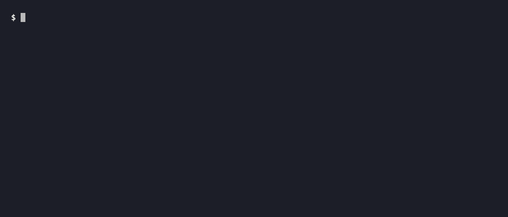

<div align="center">


<h1>lightsout</h1>

<p>Quit all applications with one terminal command.</p>

<p><a href="https://lightsout-cli.vercel.app"><strong>lightsout-cli.vercel.app</strong></a></p>

<p>
  <a href="https://github.com/abhisheksinha1506/lightsout/releases/latest"></a>
  <a href="https://github.com/abhisheksinha1506/lightsout/actions/workflows/ci-cd.yml"></a>
  <a href="https://codecov.io/gh/abhisheksinha1506/lightsout"></a>
  <a href="https://scorecard.dev/viewer/?uri=github.com/abhisheksinha1506/lightsout"></a>
  <a href="https://pkg.go.dev/github.com/abhisheksinha1506/lightsout"></a>
</p>

<p>
  <a href="https://launchstall.com" target="_blank" rel="noopener"></a>
  &nbsp;
  <a href="https://megalaun.ch/" target="_blank" rel="noopener"></a>
</p>

</div>

lightsout asks every open desktop application on macOS, Linux or Windows to
quit, except the terminal you run it from and any apps you tell it to keep.

> [!NOTE]
> lightsout asks apps to quit the normal way, so an app with unsaved work can
> ask you to save first. Any app still open after 10 seconds is left running
> and listed at the end. Nothing is force quit.



## Install

### macOS

```bash
brew install abhisheksinha1506/tap/lightsout
```

The first time you run lightsout, macOS asks whether your terminal may control
Finder, so it can close Finder's windows. Allow it; macOS only asks once.

### Linux

Download the `.deb` (Debian, Ubuntu) or `.rpm` (Fedora, openSUSE) package for
your architecture from the
[releases page](https://github.com/abhisheksinha1506/lightsout/releases) and
install it, which also installs the `wmctrl` and `xprop` tools lightsout needs:

```bash
sudo apt install ./lightsout_*_linux_amd64.deb
```

```bash
sudo dnf install ./lightsout_*_linux_amd64.rpm
```

Or download the archive (amd64, arm64, armv6 or armv7), extract it, and put
`lightsout` somewhere on your `PATH`. lightsout finds windows with `wmctrl`
and `xprop`, so install both yourself in that case. On Debian or Ubuntu:

```bash
sudo apt install wmctrl x11-utils
```

These tools work on X11 desktops. In a Wayland session, only apps running
through XWayland can be seen and closed; lightsout warns you when it detects
one.

### Windows

With [Scoop](https://scoop.sh):

```powershell
scoop bucket add abhisheksinha1506 https://github.com/abhisheksinha1506/scoop-bucket
scoop install abhisheksinha1506/lightsout
```

Or download the `.zip` for your architecture (amd64, or arm64 for Windows on ARM)
from the [releases page](https://github.com/abhisheksinha1506/lightsout/releases),
extract it, and put `lightsout.exe` in a folder on your `PATH`. Run it from Windows Terminal,
PowerShell or Command Prompt.

lightsout isn't code-signed, so Windows SmartScreen may warn the first time you
run it. Choose **More info**, then **Run anyway**.

### With Go

If you have Go installed, on any of the three systems:

```bash
go install github.com/abhisheksinha1506/lightsout@latest
```

This builds from source, so the version shows as `dev` and the update check
is skipped.

## Usage

```bash
lightsout --dry-run   # see what would be quit, without quitting anything
lightsout             # quit it all
```

1. lightsout lists the running applications: on macOS, the apps in your Dock;
   on Linux, the apps with open windows; on Windows, the apps on your taskbar.
2. It keeps open the app you're running it from. It finds that app by
   following its own parent processes (your shell, then the terminal or
   editor that started it). When it can't tell, for example over SSH or
   inside tmux, it lists the apps and asks you to type the number of the one
   you're in; type <kbd>0</kbd> if that app is already kept open.
3. It asks every other app to quit and waits up to 10 seconds for each. On
   macOS it also closes all Finder windows, and on Windows all File Explorer
   windows.

Press <kbd>Ctrl</kbd>+<kbd>C</kbd> at the question to cancel before anything
is quit.

To keep more apps open for one run, pass their names. Use the names exactly as
lightsout lists them, and quote names that contain spaces:

```bash
lightsout Slack "Google Chrome"
```

To always keep an app open, add it to your config with `keep` (and take it
out again with `unkeep`):

```bash
lightsout keep Spotify "Google Chrome"
lightsout unkeep Spotify
```

| Option | Effect |
| --- | --- |
| `-n`, `--dry-run` | List the apps that would be asked to quit, and quit nothing |
| `-y`, `--yes` | Never ask which app you're running from. If lightsout can't detect it, it stops without quitting anything, so it is safe in scripts and schedules |
| `--timeout SECS` | Wait this long (1–300 seconds, default 10) for each app to quit |
| `-h`, `--help` | Show usage |
| `-v`, `--version` | Show the version |

Any other argument starting with `-` is an error (exit status 2), so a
mistyped option never starts a run.

If an app can't be quit, or is still open after the timeout (for example
because it is asking you to save), lightsout prints a warning and carries on
with the rest. At the end it lists every app it couldn't quit and exits with
status 1. On Windows, apps running as administrator can't be closed by a
normal lightsout and are listed as well.

### Shell completion

Homebrew and the `.deb`/`.rpm` packages install completions for bash, zsh
and fish, and a man page (`man lightsout`). Otherwise, load them yourself:

```bash
source <(lightsout completion bash)                       # bash, in ~/.bashrc
lightsout completion zsh > "${fpath[1]}/_lightsout"       # zsh
lightsout completion fish > ~/.config/fish/completions/lightsout.fish
```

```powershell
lightsout completion powershell | Out-String | Invoke-Expression   # in $PROFILE
```

## Configuration

lightsout reads an optional config file from `~/.config/lightsout/config.yml`
(or `config.yaml`); on Windows that is
`%USERPROFILE%\.config\lightsout\config.yml`. Create the file yourself if you
need it. If your config
file lives in another folder from an older release, move it here, or its
settings won't apply.

```yaml
# Apps lightsout never quits
ignoredApps:
  - Google Chrome
  - Terminal

# Skip the update check on every run
ignoredUpdates: true
```

| Key              | Type            | Default | Effect                                                     |
| ---------------- | --------------- | ------- | ---------------------------------------------------------- |
| `ignoredApps`    | list of strings | none    | Apps to keep open. Command-line arguments are added to it. |
| `ignoredUpdates` | boolean         | `false` | Turns off the update check.                                |

If the config file exists but can't be read, lightsout stops before quitting
anything. `lightsout keep` and `unkeep` rewrite the file, so comments in it
are lost.

## FAQ

**Will I lose unsaved work?** No. lightsout sends the same request as
choosing Quit or clicking the close button, so apps can ask you to save. Apps
still open after the timeout are left running and listed. Nothing is force
quit.

**Can I run it on a schedule?** Yes, with `--yes`: for example from cron,
launchd or Task Scheduler. If lightsout can't tell which app it's running
from, it stops without quitting anything rather than guess.

**Why does macOS ask whether my terminal may control Finder?** lightsout
closes Finder's windows with AppleScript, which macOS asks you to allow once.
Quitting other apps needs no permission.

**Does it work on Wayland?** Only for apps running through XWayland; native
Wayland apps can't be listed by another program. lightsout warns you in a
Wayland session.

**Windows says "Windows protected your PC".** lightsout isn't code-signed
yet, so SmartScreen warns the first time. Choose **More info**, then **Run
anyway**.

**An app running as administrator wasn't closed.** Windows doesn't let a
normal program close an elevated one. Run lightsout as administrator, or close
that app yourself.

## Update check

Release builds ask GitHub for the latest version on each run and print a notice
when a newer one is out. If GitHub can't be reached, takes longer than 5
seconds to answer, or the check fails, lightsout carries on without it (with a
warning when GitHub answered but the check failed). Builds made from source
skip the check. To turn it off, set `ignoredUpdates: true`.

## How it works

| Platform | Lists apps with                                                                  | Asks each app to quit with                         |
| -------- | -------------------------------------------------------------------------------- | -------------------------------------------------- |
| macOS    | Dock apps from `NSWorkspace` (JavaScript for Automation through `osascript`)     | The normal Quit request, sent to each process ID   |
| Linux    | Windows from `wmctrl -l`, grouped by `WM_CLASS`; desktop and panel windows skipped | A close request to each of its windows (`wmctrl -i -c`) |
| Windows  | Taskbar windows from the Win32 API, named by each program's description           | `WM_CLOSE`, the message a window's X button sends   |

lightsout then waits for the app to exit (macOS) or for its windows to close
(Linux and Windows). On macOS, Finder windows are then closed with AppleScript,
and on Windows, File Explorer folder windows; Finder and File Explorer
themselves keep running.

## Development

You need Go 1.26 or newer. CI uses the latest stable release, and Dependabot
opens a weekly pull request for each of Go modules, GitHub Actions and the
lint Docker images.

```bash
make build-go       # download modules and check that lightsout builds
make test-go        # run the tests
make install-hooks  # run the tests before every commit that changes Go code
make local-lint     # golangci-lint, goreleaser check, hadolint and a go.mod tidy check
make docker-lint    # the same lint checks inside Docker, with nothing else to install
```

Run `make install-hooks` once after cloning; a commit is stopped if the tests
fail.

`make local-lint` needs [golangci-lint](https://golangci-lint.run),
[GoReleaser](https://goreleaser.com) and
[hadolint](https://github.com/hadolint/hadolint) installed.

The tests never quit any apps you have open. The end-to-end tests, which
open and close TextEdit, an xterm or Notepad, only run when
`LIGHTSOUT_MACOS_E2E`, `LIGHTSOUT_LINUX_E2E` or `LIGHTSOUT_WINDOWS_E2E` is
`1`, as in CI. Running `lightsout` itself does quit apps, so use
`lightsout --dry-run` while trying changes.

## Releasing

Releases are automatic. After every merge to `main`, once lint and all tests
pass, the release job reads the commit messages since the last tag
(`go run ./tools/nextversion`) and picks the next version:

| Commits since the last release                     | New version     |
| -------------------------------------------------- | --------------- |
| a breaking change (`feat!:`, `BREAKING CHANGE:`)   | v1.2.0 → v2.0.0 |
| a feature (`feat:`)                                | v1.2.0 → v1.3.0 |
| a fix (`fix:`, `perf:`)                            | v1.2.0 → v1.2.1 |
| only `docs:`, `ci:`, `chore:`, `build:`, `test:`   | no release      |

It pushes that tag and runs GoReleaser, which writes the release notes from
those `feat:` and `fix:` commits and:

- builds the binaries and publishes them as a GitHub release, with those notes,
- stamps the tag into each binary as its version, which the update check uses,
  and
- builds `.deb` and `.rpm` packages and an SBOM for each archive,
- signs the checksums file with [cosign](https://github.com/sigstore/cosign)
  (keyless, using the workflow's GitHub identity),
- updates the Homebrew cask in
  [abhisheksinha1506/homebrew-tap](https://github.com/abhisheksinha1506/homebrew-tap),
  the Scoop bucket in
  [abhisheksinha1506/scoop-bucket](https://github.com/abhisheksinha1506/scoop-bucket),
  and opens a pull request to
  [microsoft/winget-pkgs](https://github.com/microsoft/winget-pkgs).

The workflow then records build provenance for every release file. To check a
download came from this repository's release workflow:

```bash
gh attestation verify lightsout_1.2.0_darwin_arm64.tar.gz --repo abhisheksinha1506/lightsout
```

and to check the signature on the checksums file (with
[cosign](https://docs.sigstore.dev/cosign/system_config/installation/)):

```bash
cosign verify-blob --bundle lightsout_1.2.0_checksums.txt.sigstore.json \
  --certificate-identity-regexp '(?i)^https://github.com/abhisheksinha1506/lightsout/' \
  --certificate-oidc-issuer https://token.actions.githubusercontent.com \
  lightsout_1.2.0_checksums.txt
```

The workflow needs a `GORELEASER_PAT` secret that can write to these
repositories and open pull requests on `microsoft/winget-pkgs`.

Pushing a `v*` tag by hand still releases that tag.

## Changelog

See [GitHub Releases](https://github.com/abhisheksinha1506/lightsout/releases)
for what changed in each release. [CHANGELOG.md](CHANGELOG.md) covers
versions up to 1.2.0.

## Contributing

Bug reports, ideas and pull requests are welcome. Read
[CONTRIBUTING.md](CONTRIBUTING.md) first, and follow the
[code of conduct](CODE_OF_CONDUCT.md).

## License

lightsout is released under the [MIT License](LICENSE.md).

